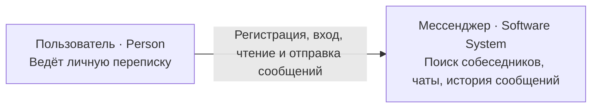
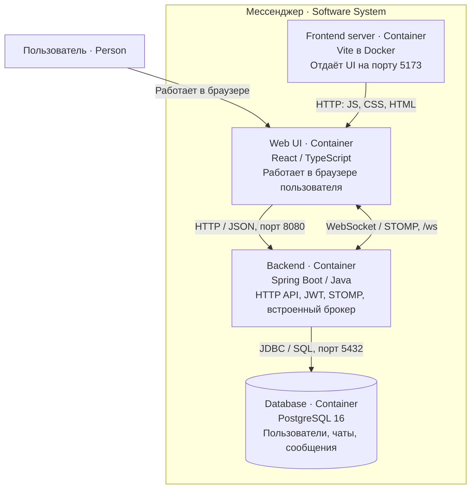
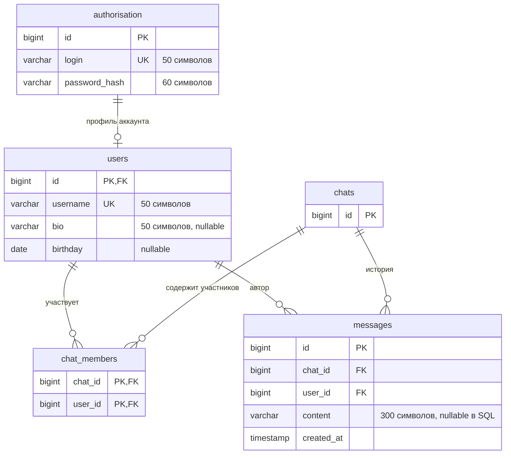
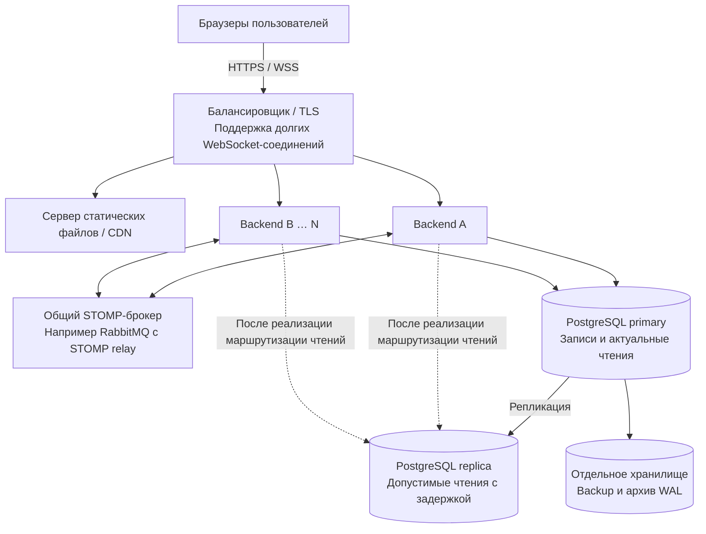

# Мессенджер

Учебный веб-сервис для личной переписки с сохранением истории и доставкой событий через WebSocket.

## Участники и согласование

| ФИО | Академическая группа | Автор в Git | Вклад в проект |
| --- | --- | --- | --- |
| Карманова Алёна | 5130904/40102 | `Alyona Karmanova`, `HuaChenju` | Разработка HTTP- и WebSocket-контрактов, контроллеров поиска пользователей и чатов; STOMP-аутентификация и проверка прав доступа; публикация событий сообщений и создания чата; индексы БД; unit- и интеграционные тесты соответствующих компонентов. |
| Познеева София | 5130904/40102 | `sonychello` | Разработка WebSocket-контроллера и сервиса отправки, редактирования и удаления сообщений; обработка ошибок WebSocket; unit-тесты сервиса сообщений. |
| Колосов Иван | 5130904/40102 | `InsomniaDemon`, `1ns_demon` | Инициализация проекта и настройка окружения; проектирование схемы БД и миграций Flyway; разработка JDBC-репозиториев и их интеграционных тестов; реализация поиска пользователей; настройка backend CI; документация. |
| Машин Андрей | 5130904/40102 | `Andrew` | Разработка интерфейса регистрации, входа и переписки, интеграция UI с HTTP API и WebSocket; авторизация и обновление JWT; сервисы регистрации и входа с unit-тестами; обработка HTTP-ошибок; Docker-конфигурация и документация. |

Тема проекта и технологический стек согласованы с преподавателем.

## 1. Определение проблемы

При личном общении через сообщения пользователям необходимо быстро находить собеседника и получать его ответы без постоянного обновления страницы. Потеря истории при закрытии приложения и невозможность исправить ошибочно отправленный текст затрудняют продолжение разговора.

## 2. Пользовательские требования

| История | Сценарий и критерии приёмки |
| --- | --- |
| Как пользователь, я хочу найти собеседника и начать разговор, чтобы обмениваться сообщениями в реальном времени. | Два пользователя регистрируются или входят; первый находит второго по имени и создаёт личный чат. Отправленное сообщение появляется у обоих без перезагрузки страницы. Посторонний пользователь не может подписаться на события чужого чата. |
| Как пользователь, я хочу продолжать разговор после возвращения в приложение, чтобы не терять контекст. | После входа доступны мои чаты и последние сообщения; более старая история загружается страницами. После перезагрузки сохранённые сообщения остаются доступны. |
| Как автор сообщения, я хочу исправить или удалить его, чтобы управлять содержанием своей переписки. | Автор редактирует или удаляет сообщение; изменение отображается у участников чата и сохраняется после перезагрузки. Попытка изменить чужое сообщение отклоняется. |

Эти операции представлены в коде frontend и backend. Полное прохождение сценариев в браузере перед сдачей необходимо подтвердить отдельно. Групповые чаты и вложения не входят в текущую реализацию.

## 3. Архитектура и детальное проектирование

### Технологический стек и границы системы

- UI: React, TypeScript, Vite; HTTP-запросы через Fetch API, STOMP поверх WebSocket через `@stomp/stompjs`.
- Backend: Java 21 как целевая версия компиляции, Spring Boot, Spring Security, JWT, JDBC; Dockerfile использует JDK 26 для сборки и исполнения.
- Хранилище: PostgreSQL 16, миграции Flyway.
- Сборка и окружение: Maven Wrapper, npm, Docker Compose.
- Контракты: OpenAPI 3.1 для HTTP, отдельное описание WebSocket.

### C4 Level 1 — System Context

Обозначения: человек взаимодействует с системой; граница системы включает UI, backend и собственную БД.



### C4 Level 2 — Container

Контейнер в C4 — исполняемое приложение или хранилище. Диаграмма показывает ответственность компонентов и протоколы связи.



В локальной конфигурации браузер обращается к `localhost:8080`, а backend — к `postgres:5432` внутри сети Compose. Оповещение о создании чата отправляется после успешной фиксации транзакции. События встроенного брокера не являются долговременной очередью: после повторного подключения клиент должен восстановить состояние через HTTP.

### Аудитория, срок хранения и профиль нагрузки

Далее приведены **проектные допущения**, а не результаты измерений. Расчётный базовый профиль — 10 000 активных пользователей в сутки (DAU), до 100 000 зарегистрированных пользователей, 1 000 одновременных WebSocket-соединений и в среднем 20 личных чатов на аккаунт. Срок хранения сообщений — 6 лет, кроме сообщений, явно удалённых автором.

| Параметр | Допущение и расчёт |
| --- | --- |
| Отправка сообщений | 40 на активного пользователя в сутки: 400 000 новых сообщений/сутки |
| Операции чтения | 200 HTTP-запросов на активного пользователя: 2 000 000/сутки; доставка WebSocket учитывается отдельно |
| Прочие записи | 20 000 операций/сутки: регистрация, создание чатов, редактирование и удаление |
| Соотношение R/W | 2 000 000 / 420 000 ≈ 4,8 : 1 по прикладным операциям; одна операция может выполнять несколько SQL-запросов |
| Средняя нагрузка | Чтение ≈ 23,1 запроса/с, запись ≈ 4,9 операции/с; всего ≈ 28 операций/с |
| Пиковая нагрузка | Коэффициент 10 к среднесуточной: ≈ 231 чтение/с и 49 записей/с |
| Доставка событий | До двух событий на новое сообщение для двух подключённых участников с одной сессией у каждого: 800 000 доставок/сутки, ≈ 93/с в пик; дополнительные вкладки увеличат число |

Объём трафика рассчитан в десятичных GB (1 GB = 10⁹ байт):

- При среднем HTTP-ответе 10 KB: 2 000 000 × 10 KB = 20 GB/сутки исходящего HTTP-трафика. Это усреднение смеси списков, страниц истории и поиска.
- При размере события 1 KB: 800 000 × 1 KB = 0,8 GB/сутки исходящего WebSocket-трафика.
- При среднем запросе/команде записи 1 KB: 420 000 × 1 KB = 0,42 GB/сутки входящих данных записи.
- Вместе: около 21,2 GB/сутки; с бюджетом 30% на заголовки, служебные сообщения, запросы чтения и повторные подключения — около 28 GB/сутки. Средняя полоса ≈ 2,6 Мбит/с, расчётный пик ≈ 26 Мбит/с. Загрузка статики UI и массовый одновременный вход требуют отдельного бюджета.

Оценка диска при постоянном базовом потоке без вычитания удалений:

- 400 000 × 365 × 6 = 876 000 000 сообщений; високосные дни покрываются запасом.
- Бюджет на строку сообщения с учётом текста, заголовка строки, выравнивания, первичного и составного индексов — 1 KB. Это консервативное среднее для короткого текста, а не измеренный размер таблицы.
- Сообщения с индексами: около 876 GB; пользователи, авторизация, чаты и участники: бюджет 10 GB.
- С 30% эксплуатационного запаса: (876 + 10) × 1,3 ≈ 1,15 TB на основное хранилище. Отдельный бюджет 0,5 TB на локальный WAL и временные файлы; фактическое удержание WAL зависит от настроек и репликации.
- Полная реплика потребует сопоставимый объём отдельно. Для двух полных резервных копий без предположения о сжатии — дополнительно около 1,8 TB плюс инкременты/WAL за выбранный период восстановления. Резервные копии должны храниться вне основного узла; их политика требует настройки.

### API и нефункциональные требования

Подробный HTTP-контракт: [backend/docs/openapi.yaml](backend/docs/openapi.yaml). Подключение, команды, события и ошибки STOMP: [backend/docs/websocket.md](backend/docs/websocket.md).

| Операция | Контракт |
| --- | --- |
| Регистрация | `POST /api/auth/register`: username, login, password, birthday → token, user |
| Вход | `POST /api/auth/login`: login, password → token, user |
| Продление доступа | `POST /api/auth/refresh`, Bearer JWT → token; требуется ещё действующий access token, отдельного refresh token нет |
| Поиск пользователей | `GET /api/users/search?username=...&limit=20`; максимум 50 результатов |
| Список чатов | `GET /api/chats` → items |
| Создание чата | `POST /api/chats`, memberId → id, members; событие CHAT_CREATED участникам |
| История | `GET /api/chats/{chatId}/messages?limit=50&beforeMessageId=...`; максимум 100 сообщений |
| Сообщения | STOMP-команды отправки, редактирования и удаления; события в `/topic/chats/{chatId}/events` |

Целевые показатели при базовом пиковом профиле, прогретом приложении и доступной БД:

| Показатель | Цель |
| --- | --- |
| Поиск, список чатов, страница истории | p95 ≤ 300 мс |
| Создание чата, обновление JWT | p95 ≤ 500 мс |
| Регистрация и вход с вычислением BCrypt | p95 ≤ 1 000 мс |
| Доставка нового сообщения подключённому собеседнику | p95 ≤ 500 мс от отправки команды до получения события в тестовой сети |
| Ошибки сервера при нагрузочном прогоне | Менее 1% операций; ожидаемые отказы авторизации не учитываются |

p95 означает, что 95% замеров не превышают порог. HTTP-время измеряется клиентом от отправки запроса до получения ответа; задержка сообщений — между двумя клиентами. Это критерии будущей нагрузочной проверки, а не подтверждённые свойства текущей реализации. Для воспроизводимости нужно записать характеристики CPU/RAM/SSD, длительность прогона, объём тестовой БД и число соединений.

### Схема базы данных

Источник схемы: [V1__init_schema.sql](backend/src/main/resources/db/migration/V1__init_schema.sql); дополнительные индексы: [V2__add_chat_indexes.sql](backend/src/main/resources/db/migration/V2__add_chat_indexes.sql).



Первичные и внешние ключи обеспечивают уникальность и ссылочную целостность. Уникальные login и username защищают от дублирования аккаунтов. Регистрация и создание чата выполняются транзакционно.

Индекс `messages(chat_id, created_at DESC, id DESC)` соответствует выборке последних сообщений одного чата с сортировкой и LIMIT. Индекс `chat_members(user_id, chat_id)` ускоряет список чатов пользователя; составной первичный ключ `(chat_id, user_id)` — проверку членства. Постраничное чтение ограничивает размер ответа и не требует OFFSET по всей истории. Поэтому основные пути чтения имеют подходящие индексы, но достижение p95 требует замеров на репрезентативном объёме данных.

### Масштабирование при росте нагрузки в 10 раз

Целевой профиль: 100 000 DAU, 10 000 одновременных соединений, 4 млн сообщений/сутки, около 2 800 прикладных операций/с в пик, около 280 GB трафика/сутки. При таком потоке на протяжении всех шести лет основной объём с запасом будет около 11,5 TB без WAL, реплик и резервных копий.

Следующая диаграмма показывает проектную архитектуру при росте нагрузки в 10 раз.



1. Раздавать собранный UI статическим сервером; завершать TLS на балансировщике. Добавлять backend-экземпляры по CPU, числу соединений и задержкам. Использовать общий JWT-ключ и ограниченные пулы подключений к БД.
2. Заменить локальный `enableSimpleBroker` на общий брокер с relay: события должны достигать клиентов на любом backend-узле. Отдельно настроить межузловую маршрутизацию персональных `/user/queue/*` уведомлений. После реконнекта восстанавливать историю через HTTP.
3. Использовать пакетную загрузку данных чатов и триграммный индекс для поиска по имени. Реплику подключать только для чтений, где допустима задержка; чтения сразу после записи оставлять на primary.
4. При фактической необходимости спроектировать секционирование messages и архивирование старой истории. Для секционирования по времени потребуется отдельно переработать глобальный PK id и запросы: простого включения секционирования недостаточно.
5. Настроить резервные копии и проверку восстановления. Измерять p95, частоту ошибок, соединения, задержку брокера, SQL-планы, I/O и рост WAL. Число узлов и их ресурсы определить нагрузочным тестом; эта схема сама по себе не доказывает производительность.

## 4. Реализация и отладка

Backend разделён на контроллеры, сервисы, репозитории, конфигурацию безопасности и публикацию событий. Контроллеры HTTP работают с JWT, сервисы реализуют сценарии, JDBC-репозитории сохраняют данные. Пользовательские пароли хранятся в виде BCrypt-хешей; access token действует семь суток. STOMP-перехватчики проверяют JWT и допустимость команд и подписок. Frontend содержит функции регистрации, входа и переписки, общий HTTP-клиент и управление STOMP-соединением.

Для отладки используются журналы backend (`docker compose logs -f backend`) и вкладки Network/Console браузера. При изменении схемы БД нужно добавлять новую миграцию Flyway, сохраняя уже применённые миграции.

## 5. Unit-тестирование

В `backend/src/test/java` находятся JUnit-тесты с Mockito: сервисы регистрации, входа, поиска, чатов и сообщений; JWT/STOMP-перехватчики; публикация событий. Проверяются успешные операции, ошибки учётных данных, дублирование аккаунтов, запреты изменения чужих сообщений и недопустимых подписок. Это проверки поведения приложения; сам факт наличия тестов не означает успешного выполнения.

Команда из каталога `backend` для unit-тестов без интеграционных тестов и загрузки полного Spring-контекста:

```sh
./mvnw '-Dtest=*Test,!*IntegrationTest' test
```

Не запускалась при подготовке отчёта. Отчёты после выполнения находятся в `backend/target/surefire-reports`.

## 6. Интеграционное тестирование

Тесты репозиториев работают с PostgreSQL 16 через Testcontainers. `ChatCreatedTransactionIntegrationTest` проверяет уведомление после фиксации транзакции; `WebSocketIntegrationTest` — подключение с валидным JWT и отказы при отсутствующем или просроченном токене. Эти проверки не заменяют полный сценарий доставки сообщения между двумя браузерами.

Нужны установленная JDK 21+ и работающий Docker, доступный Testcontainers. Из каталога `backend`:

```sh
./mvnw '-Dtest=*IntegrationTest' test
```

Для всех тестов используется `./mvnw test`. Отдельный `BackendApplicationTests` загружает Spring-контекст без контейнера и потому требует доступную БД по `DB_HOST`, `DB_PORT`, `DB_USER`, `DB_PASSWORD` или локальным значениям из `application.yaml`. Можно предварительно запустить `docker compose up -d postgres` из корня проекта. Прогон всех тестов при подготовке отчёта не выполнялся; результаты и число пройденных тестов нужно зафиксировать после запуска.

### Ручной приёмочный сценарий

1. Запустить приложение и открыть два разных профиля браузера либо обычное и приватное окно.
2. Зарегистрировать двух пользователей с разными login и username.
3. Найти второго пользователя по имени, создать чат, отправить сообщение и проверить его появление в обоих окнах без обновления страницы.
4. Перезагрузить страницы, повторно открыть чат и проверить сохранение истории; накопить больше одной страницы сообщений и проверить подгрузку.
5. Отредактировать и удалить своё сообщение, проверить синхронизацию и результат после перезагрузки.
6. Третьим пользователем проверить отказ доступа к чужим событиям, истории и изменению сообщений.

Статус: сценарий подготовлен, выполнение не подтверждено.

## 7. Сборка и запуск

Требования: Docker Engine с Docker Compose v2; для первой сборки нужен доступ к реестрам контейнеров, Maven- и npm-зависимостям. Локальный запуск использует порты 5173 (UI), 8080 (backend), 5433 (PostgreSQL на хосте).

Из корня проекта сгенерировать локальный Base64-ключ из 32 случайных байт и сохранить его в `.env`:

```sh
printf 'JWT_SECRET=%s\n' "$(openssl rand -base64 32)" > .env
```

Команда перезаписывает `.env`: если файл уже существует, добавить или заменить только `JWT_SECRET`, сохранив остальные параметры. Не использовать текстовый placeholder из `.env.example` как рабочий ключ и не публиковать рабочие секреты.

```sh
docker compose up --build -d
docker compose ps
docker compose logs -f backend
```

- UI: http://localhost:5173
- Backend: http://localhost:8080
- WebSocket: ws://localhost:8080/ws
- PostgreSQL с хоста: localhost:5433; база, пользователь и пароль локального стенда — `messenger`.

Flyway применяет миграции при старте backend. Для backend задана политика перезапуска `restart: unless-stopped`. При необходимости повторного запуска после готовности PostgreSQL выполнить `docker compose restart backend` и проверить журналы.

Данные БД сохраняются в именованном томе `postgres_data`. Остановить стенд с сохранением данных:

```sh
docker compose down
```

Backend собирается Dockerfile через Maven с пропуском запуска тестов; тесты нужно запускать отдельно. Frontend-контейнер запускает Vite dev server, поэтому Compose показывает учебный стенд. Для отдельной проверки компиляции UI из каталога `frontend` выполнить `npm ci` и `npm run build`.

При подготовке отчёта сборка, запуск Compose и рендер диаграмм в GitHub не проверялись. Mermaid-блоки должны отображаться как диаграммы при просмотре README на GitHub.

## Что остаётся перед сдачей

- Проверить сборку с чистой БД, тесты и ручной сценарий, записать фактические результаты. Нагрузочные цели пока не подтверждены измерениями.
- Проверить отображение диаграмм в публичном репозитории и наличие коммитов каждого заявленного участника.
- Получить явное подтверждение преподавателя, что проект принят; после этого загрузить ZIP проекта и отчёта на https://dl.spbstu.ru.

---

## 🏗️ Структура проекта

| Layer | Component | Technology | Description |
|-------|-----------|------------|-------------|
| **Frontend** | UI | React + Vite | Пользовательский интерфейс с компонентной архитектурой |
| | State | Context API | Управление глобальным состоянием |
| | API Client | Fetch API | HTTP-запросы к бэкенд-сервисам |
| | Routing | React Router | Навигация на стороне клиента |
| **Backend** | Application | Java 21 + Spring Boot | Монолитное серверное приложение |
| | Authentication | Spring Security + JWT | Аутентификация и авторизация пользователей |
| | Messaging | WebSockets | Обмен сообщениями в реальном времени |
| **Database** | PostgreSQL | SQL | Реляционная база данных для пользователей и сообщений |

### Backend модули
```text
messenger-pet-project
├───backend
|   ├───docs
│   │   └───openapi.yaml
│   │
│   ├───src
│   │   ├───main
│   │   │   ├───java
│   │   │   │   └───messenger
│   │   │   │       └───backend
│   │   │   │           ├───config
│   │   │   │           ├───controllers
│   │   │   │           ├───dtos
│   │   │   │           ├───exceptions
│   │   │   │           ├───messaging
│   │   │   │           ├───repositories
│   │   │   │           ├───security
│   │   │   │           ├───services
│   │   │   │           └───BackendApplication.java
│   │   │   └───resources
│   │   │       ├───db
│   │   │       │   └───migration
│   │   │       │       ├───V1__init_schema.sql
│   │   │       │       └───V2__add_chat_indexes.sql
│   │   │       └───application.yaml
│   │   └───test
│   │       └───java
│   │           └───messenger
│   │               └───backend
│   │                   ├───messaging
│   │                   ├───repositories
│   │                   ├───security
│   │                   └───services
│   ├───Dockerfile
│   └───pom.xml
├───frontend
│   ├───public
│   ├───src
│   │   ├───assets
│   │   │   ├───fonts
│   │   │   └───images
│   │   │
│   │   ├───features
│   │   │   ├───auth
│   │   │   │   ├───api
│   │   │   │   ├───components
│   │   │   │   ├───pages
│   │   │   │   ├───styles
│   │   │   │   └───types.ts
│   │   │   │
│   │   │   └───chats
│   │   │       └───...
│   │   │
│   │   ├───shared
│   │   │   ├───api
│   │   │   ├───context
│   │   │   ├───styles
│   │   │   ├───utils
│   │   │   └───types.ts
│   │   │
│   │   ├───App.tsx
│   │   ├───AppRoutes.tsx
│   │   └───main.tsx
│   │
│   └───Dockerfile
└───docker-compose.yml
```
## Правила построения коммитов

### Компоненты

| Компонент | Описание |
|-----------|----------|
| `FRONTEND` | Vite + React frontend |
| `BACKEND` | Общие backend изменения |
| `DEVOPS` | Docker, настройка окружения |
| `DB` | Изменения в базе данных |
| `DOCS` | Документация |

### Типы изменений (для backend)

| Тип | Описание |
|-----|----------|
| `REPOS` | api для БД |
| `SERVICE` | сервисы (например авторизация и тд.) |

### Конкретика

```text
Можно через ещё один слеш написать конкретный сервис/репозиторий над которым ведётся работа (можно и несколько через +).
Так-же через ещё один слеш написать TESTS, понятно для чего
```

### Примеры

```text
[FRONTEND] Добавлена страница логина
[BACKEND/REPOS/AUTH+USER] added
[BACKEND/SERVICE/CHAT] Исправлена отправка сообщений
[FRONTEND] Обновлен дизайн чата
[DB] Добавлена таблица messages
[DOCS] Обновлен README.md
[BACKEND/SERVICE/AUTH+CHAT] Обновлена общая модель UserDTO
```

## Правила названия веток

```text
Тоже самое, что в коммитах, только после Компонента нужно написать следующее:
```
| Действие | Описание |
|-----------|----------|
| `ADD` | Добавление |
| `FIX` | Исправление бага |
| `UPDATE` | Обновление |
| `REFACTOR` | Переработка |
```text
(ну и с маленькой буквы через слеш, а не в квадратных скобочках капсом)
```

## Правила PR

```text
Называйте PR подобно веткам.
Мерджить вы можете сами, так что когда считаете нужными сливаете свою ветку с мейном, если что - советуйтесь с остальными
Изменения должны быть законченными.
ОБЯЗАТЕЛЬНО когда мёрджите изменения делайте сквош коммит. Он объединяет все ваши коммиты в один, что позволяет оставить историю коммитов репозитория чистой.
ОБЯЗАТЕЛЬНО удаляйте ветку, после того как её слили. (там в том же месте где кнопка мёрджа появляется кнопка удаления ветки)
Перед тем как сливать ветку, убедитесь, что в ней есть коммиты из актуального мейн, если это не так. Спульте изменения в свою мейн ветку, сделайте ребейз, и , запушив, сливайте ветку.
Если что пишите - разберёмся.
```

## Про названия веток, коммитов и PR

```text
Это не жёсткий свод правил, а лишь рекомендации, которым желательно следовать.
Но не надо изгаляться в попытках написать в строгом соответствии с ними, есть место для импровизации. 
```
